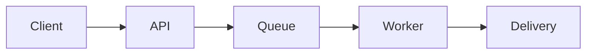

# Notification Service — Design Notes

A public sample describing a notification API and its delivery worker.
**Use request IDs to prevent duplicates, and retry at most three times.**

## Request flow



## Review points

| Item | Design decision |
| --- | --- |
| Idempotency | Retain request IDs for 24 hours |
| Retries | Three attempts with exponential backoff |
| Timeout | Five seconds per destination |

## Configuration example

```json
{
  "retries": 3,
  "timeoutSeconds": 5,
  "idempotencyWindowHours": 24
}
```

## Review notes

Check destination load during retry bursts and duplicate delivery after timeouts.
Compare the document with the code and operating conditions.
