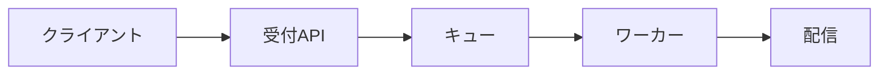

# 通知サービスの設計メモ

通知を受け付けるAPIと、配信ワーカーの処理を整理した公開サンプルです。
**リクエストIDで重複を防ぎ、再試行は最大3回に制限します。**

## リクエストの流れ



## 確認するポイント

| 項目 | 設計上の判断 |
| --- | --- |
| 重複防止 | リクエストIDを24時間保持 |
| 再試行 | 最大3回・指数バックオフ |
| タイムアウト | 配信先ごとに5秒 |

## 設定例

```json
{
  "retries": 3,
  "timeoutSeconds": 5,
  "idempotencyWindowHours": 24
}
```

## レビューのメモ

再試行が集中したときの負荷と、タイムアウト後の重複配信を確認します。
文書、コード、運用条件が一致しているかを順に確かめます。
