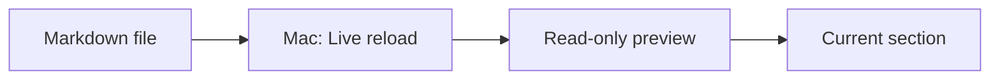

# Ayami

This file verifies that **Markdown** opens as a rendered, read-only document.

## Supported content

- Headings and paragraphs
- **Bold**, *emphasis*, and [links](https://example.com)
- Ordered and unordered lists
- Tables and code blocks
- Text selection
- Live reload after an external editor saves (Mac only)
- Saved text-size adjustment from 80% to 160%
- A chapter outline that follows the reading position
- Offline Mermaid diagrams

| Component | Choice |
| --- | --- |
| UI | SwiftUI |
| Renderer | Textual 0.5.0 |
| Document mode | Viewer |

```swift
DocumentGroup(viewing: MarkdownDocument.self) {
    PreviewView(document: $0.document, fileURL: $0.fileURL)
}
```

## Mermaid without setup

The diagram below is rendered locally. It does not use a CDN or require a
Mermaid installation.



## Read-only by design

Ayami intentionally does not include an editor or Quick Look extension.
