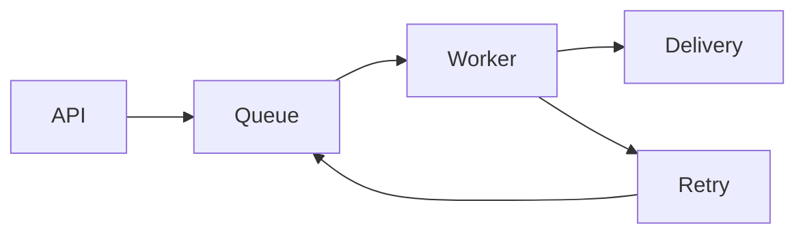

# Notification Service — Design Review

A public sample for reading README files, design documents, and AI-generated Markdown with diagrams and code.

**Review focus:** Retry at most three times. Require a request ID for idempotency to prevent duplicate notifications.

## 1. Request flow



| Review item | Design decision | Status |
| --- | --- | --- |
| Idempotency | Retain request IDs for 24 hours | Review needed |
| Retries | Three attempts with exponential backoff | Checked |
| Timeout | Five seconds per destination | Review needed |

## 2. API example

Copy the following code to try it in a local test environment. No real service or credentials are included.

```sh
curl --request POST http://localhost:8080/notifications \
  --header 'Content-Type: application/json' \
  --header 'Idempotency-Key: review-example-001' \
  --data '{"channel":"test","message":"Hello, Ayami"}'
```

Reuse the request ID after errors. Move notifications that reach the retry limit into a queue for manual recovery.

## 3. Related documents and images


- [Read the operations guide](docs/operations-en.md)
- [Jump to incident response](docs/operations-en.md#incident-response)
- [Jump to review checklist](#4-review-checklist)

## 4. Review checklist

- Does the idempotency retention period exceed the retry window?
- Does the system limit destination load during retry bursts?
- Can timeouts and retries result in duplicate delivery?
- Does the AI-generated description match the actual code and operating conditions?

Select a passage and use the highlighter in the toolbar. Marks disappear when the document closes and are never saved to Markdown or PDF.

## 5. HTML and source files

<details><summary>Open the HTML note</summary>
<p>Read HTML <strong>formatting</strong>, tables, and expandable details.</p>
<table><tr><th>Review item</th><th>Value</th></tr><tr><td>Mode</td><td>Read only</td></tr></table>
</details>

- [Operations note (TXT)](docs/notes.txt)
- [Configuration (JSON)](docs/config.json)
- [C source code](docs/example.c)
- [HTML report](docs/report-en.html)
- [Text with another extension](docs/notes.example)

On Mac, document links open in a new tab by default. Choose a new window instead in Reading Settings.
