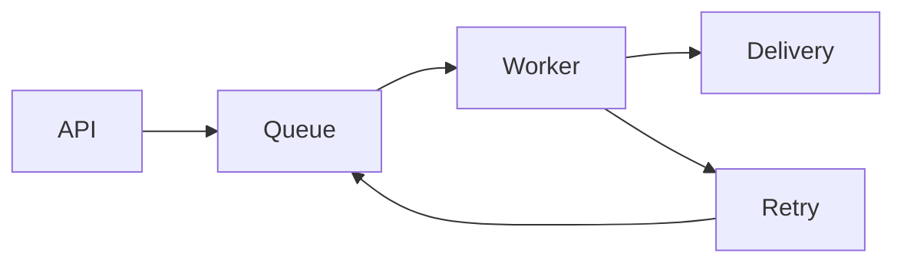
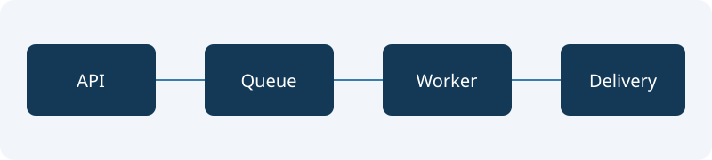

# 通知サービス 設計レビュー

README・設計書・AI生成文書を、図とコードを確認しながら読み進める公開サンプルです。

**レビューの要点：** リトライは最大3回。重複通知を防ぐため、リクエストIDによる冪等性を必須とします。

## 1. 処理の流れ



| 確認項目 | 設計上の判断 | 状態 |
| --- | --- | --- |
| 冪等性 | リクエストIDを24時間保持 | 要レビュー |
| リトライ | 最大3回・指数バックオフ | 確認済み |
| タイムアウト | 送信先ごとに5秒 | 要レビュー |

## 2. APIの利用例

以下のコードをコピーして、ローカルの検証環境で確認できます。実在するサービスや秘密情報は含みません。

```sh
curl --request POST http://localhost:8080/notifications \
  --header 'Content-Type: application/json' \
  --header 'Idempotency-Key: review-example-001' \
  --data '{"channel":"test","message":"Hello, Ayami"}'
```

エラー時も同じリクエストIDを利用します。リトライ上限に達した通知は、再送用キューに移します。

## 3. 関連資料と画像



- [運用手順書を読む](docs/operations.md)
- [運用手順書の障害対応へ移動](docs/operations.md#障害対応)
- [この文書のレビュー項目へ移動](#4-レビュー項目)

## 4. レビュー項目

- 冪等性の保持期間は、再送期間より長いか。
- リトライが集中したとき、送信先への負荷を抑えられるか。
- タイムアウトと再送により、同じ通知が二重配信されないか。
- AI生成の説明と、実際のコード・運用条件が一致するか。

気になる文章を選び、ツールバーの蛍光ペンでマークできます。マークは文書を閉じると消え、元のMarkdownやPDFには保存されません。

## 5. HTMLとソースを読む

<details><summary>HTMLによる補足を開く</summary>
<p>HTMLの<strong>強調</strong>、表、折りたたみも表示できます。</p>
<table><tr><th>確認項目</th><th>値</th></tr><tr><td>表示モード</td><td>読み取り専用</td></tr></table>
</details>

- [運用メモ（TXT）](docs/notes.txt)
- [設定例（JSON）](docs/config.json)
- [Cのソースコード](docs/example.c)
- [HTMLのレポート](docs/report.html)
- [その他の拡張子のテキスト](docs/notes.example)

Macでは、文書リンクは標準で新しいタブに開きます。表示設定から新しいウィンドウに切り替えられます。
